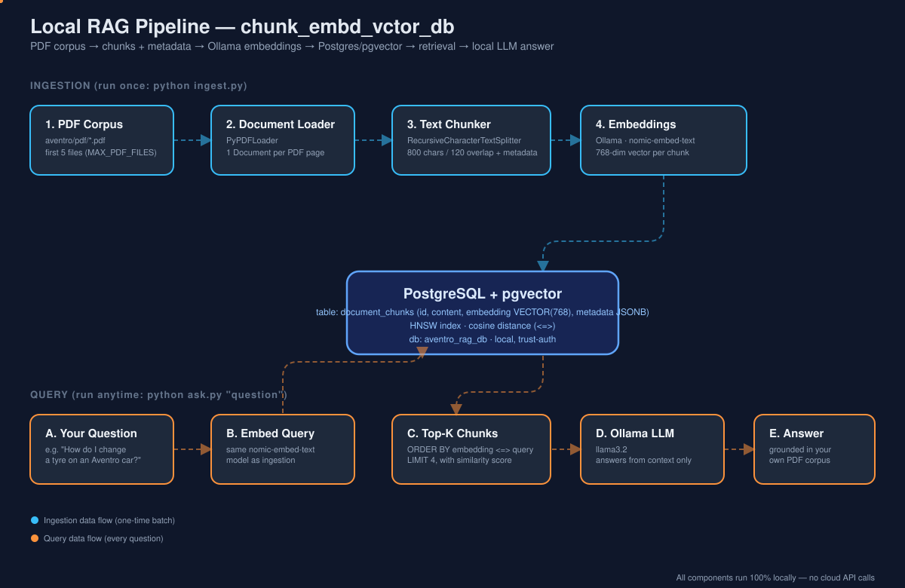

# chunk_embd_vctor_db — A Minimal, Fully-Local RAG Pipeline

A first RAG (Retrieval-Augmented Generation) project built to be **small, readable,
and 100% local**: no API keys, no cloud services. It loads a handful of PDFs,
chunks them with rich metadata, embeds the chunks with a local Ollama model,
stores everything in Postgres with the `pgvector` extension, and answers
questions by retrieving the most relevant chunks and handing them to a local
LLM.



---

## What is RAG, in one paragraph?

A plain LLM only knows what it learned during training — it can't answer
questions about *your* private documents, and it can confidently make things
up when it doesn't know an answer ("hallucination"). **RAG** fixes this by
inserting a retrieval step before generation: you turn your documents into
*searchable* numeric vectors ("embeddings"), store them in a vector database,
and at query time, find the chunks most similar in meaning to the user's
question, then paste those chunks into the LLM's prompt as context. The LLM
answers *from that context* instead of from memory alone. This project
implements exactly those two halves — **ingestion** (build the searchable
index) and **query** (search it + answer) — as two separate, runnable scripts.

---

## Architecture

| # | Stage | File | What it does |
|---|-------|------|---------------|
| 1 | Document Loader | `document_loader.py` | Reads the first few PDFs from the corpus using `PyPDFLoader`, one `Document` per page. |
| 2 | Text Chunker | `text_chunker.py` | Splits each page into ~800-char overlapping chunks with `RecursiveCharacterTextSplitter`, and attaches detailed metadata to every chunk. |
| 3 | Embeddings | `embedder.py` | Converts each chunk's text into a 768-dim vector using the local Ollama model `nomic-embed-text`. |
| 4 | Vector Store | `vector_store.py` | Stores chunk text + vector + metadata in Postgres (`pgvector` extension), with an HNSW cosine-distance index for fast search. |
| 5 | Ingestion pipeline | `ingest.py` | Wires stages 1–4 together: `python ingest.py` runs the whole batch job. |
| 6 | Query pipeline | `ask.py` | Embeds your question, retrieves the top-K most similar chunks, and (optionally) asks a local LLM (`llama3.2`) to answer using only those chunks. |
| — | Preflight checks | `test_setup.py` | Verifies the PDF corpus, Ollama, and Postgres are all reachable before you run ingestion. |

---

## Why each design choice? (notes for junior devs)

**Why chunk documents instead of embedding whole pages/files?**
Embedding models compress text into a *fixed-size* vector. A whole PDF page
mixes many ideas into one vector, which blurs its meaning and hurts search
precision. Smaller, focused chunks produce sharper embeddings and more
relevant retrieval results.

**Why overlap chunks (`CHUNK_OVERLAP=120`)?**
Without overlap, a sentence that happens to straddle a chunk boundary gets
cut in half, and *both* halves lose context. A small overlap repeats the
tail of one chunk at the start of the next, so important context isn't lost
right at the seam.

**Why store metadata, not just the vector?**
A vector alone can't tell you *where an answer came from*. Each chunk in
this project carries:

| Field | Meaning |
|---|---|
| `chunk_id` | Unique UUID — primary key in Postgres. |
| `source_file` | Which PDF this chunk came from. |
| `page` | Which page of that PDF (from `PyPDFLoader`). |
| `chunk_index` | Position of this chunk within that file's chunks. |
| `total_chunks` | How many chunks that file produced in total. |
| `chunk_char_count` | Length of the chunk text (useful for QA/debugging). |
| `chunk_size_setting` / `chunk_overlap_setting` | Splitter config used, so you can tell which run produced a given row. |
| `ingested_at` | UTC timestamp of ingestion. |

This metadata makes every answer traceable back to an exact PDF and page —
critical for trust and debugging in any real RAG system.

**Why `nomic-embed-text` via Ollama?**
It's a strong, free, fully local embedding model — no OpenAI key needed,
nothing leaves your machine. It produces 768-dimension vectors, matching the
`VECTOR(768)` column in Postgres.

**Why Postgres + pgvector instead of a dedicated vector DB (e.g. Chroma, Pinecone)?**
You likely already run Postgres for other things. `pgvector` turns it into a
capable vector database too — one less moving part to operate, with the full
power of SQL (joins, filters, transactions) alongside vector search. The
`<=>` operator computes **cosine distance** between vectors directly in SQL;
an **HNSW index** makes that search fast even as the table grows.

**Why cosine distance (not Euclidean)?**
Text embeddings mostly encode *direction* (meaning), not magnitude. Cosine
distance compares the angle between two vectors, which is a better semantic
similarity measure for this use case than raw Euclidean distance.

---

## Prerequisites

1. **Ollama**, running locally with two models pulled:
   ```bash
   ollama pull nomic-embed-text   # embedding model (768-dim)
   ollama pull llama3.2           # used only by ask.py to generate the final answer
   ollama serve                   # if not already running
   ```
2. **PostgreSQL** running locally with the `pgvector` extension installed.
   This project was tested against a local Homebrew Postgres 15 with
   `pgvector` 0.8.1 already installed.
3. **Python 3.12+**

### A note on the Postgres connection string

Your local Postgres is configured with **`trust` authentication** for
`localhost`/`127.0.0.1` (checked directly in `pg_hba.conf`), which means the
server does **not actually verify the password** for local connections — any
value works. That's why `.env.example` ships with a simple placeholder
(`POSTGRES_PASSWORD=postgres`) instead of asking you to dig up a real one.
If you later point this project at a different Postgres instance that does
enforce a real password, just put it in your own `.env`.

The pipeline connects to `localhost:5432` as user `postgres`, and creates its
**own dedicated database** called `aventro_rag_db` automatically on first run
(it does *not* write into the default `postgres` database) — so it can't
collide with any other projects/databases already on your machine.

---

## Setup

```bash
cd /Users/srinivaskotipalli/mai-practitioner/RAG/chunk_embd_vctor_db

# 1. Create and activate a virtual environment
python3 -m venv .venv
source .venv/bin/activate

# 2. Install dependencies
pip install -r requirements.txt

# 3. Configure environment variables (defaults already work out of the box)
cp .env.example .env

# 4. Confirm everything is reachable before ingesting
python test_setup.py
```

Expected output:
```
[OK] Corpus dir has 50 PDF file(s): .../corpus/aventro/pdf
[OK] Embedding model 'nomic-embed-text' available
[OK] LLM model 'llama3.2' available
[OK] Connected to Postgres at localhost:5432
[OK] pgvector extension available on this server

All checks passed -- you're ready to run: python ingest.py
```

---

## Run it

### 1. Ingest a few PDFs

```bash
python ingest.py            # append to the table
python ingest.py --reset    # wipe the table first, then ingest fresh
```

By default this loads the first **5** PDFs (alphabetically) from the corpus
— deliberately small, since this is a learning project. Change
`MAX_PDF_FILES` in `.env` to ingest more.

This was tested end-to-end and produces output like:

```
STEP 1/4: Loading PDF documents
  loaded  Aventro Motors- How to Change a Tyre.pdf     -> 3 page(s)
  loaded  AventroZoom SUV.pdf                          -> 3 page(s)
  ...
Total: 5 PDF file(s), 14 page-document(s)

STEP 2/4: Chunking + building metadata
   Aventro Motors- How to Change a Tyre.pdf     -> 5 chunk(s)
  ...
Chunked 14 page-document(s) into 28 chunk(s) total

STEP 3/4: Generating embeddings (Ollama)
Embedded 28 chunk(s) with 'nomic-embed-text' (768 dimensions)

STEP 4/4: Storing in Postgres + pgvector
Created database 'aventro_rag_db'
Schema ready: table 'document_chunks' (db 'aventro_rag_db') with HNSW cosine index
Inserted 28 chunk(s) into 'document_chunks'

Ingestion complete
  PDF files processed : 5
  Chunks stored       : 28
  Table               : document_chunks (db: aventro_rag_db)
  Total rows in table : 28
```

### 2. Ask a question

```bash
python ask.py "How do I change a tyre on an Aventro car?"
```

```
Query: How do I change a tyre on an Aventro car?
Top 4 chunk(s) by cosine similarity:

[1] similarity=0.7951 |  Aventro Motors- How to Change a Tyre.pdf (chunk 0)
    A ventro Motors: How to Change a Tyre Changing a flat tyre is a basic...
...
Generating answer with local LLM...
----------------------------------------------------------------------
Answer:
To change a tyre on an Aventro car, follow these steps:
1. Park Safely: Pull over to a safe, flat location away from traffic...
...
----------------------------------------------------------------------
```

Use `--no-generate` to see only the retrieved chunks (skip the LLM call):

```bash
python ask.py --no-generate "adaptive cruise control"
```

---

## Inspecting the data directly

```bash
psql -h localhost -U postgres -d aventro_rag_db

-- See everything stored for one chunk, including metadata
SELECT source_file, chunk_index, left(content, 80), jsonb_pretty(metadata)
FROM document_chunks LIMIT 1;

-- Run a raw vector similarity search yourself
-- (requires an embedding vector, usually generated via embedder.embed_query)
```

---

## Project structure

```
chunk_embd_vctor_db/
├── config.py           # all settings, loaded from .env
├── document_loader.py  # Step 1: load PDFs → Documents
├── text_chunker.py     # Step 2: split into chunks + add metadata
├── embedder.py          # Step 3: chunks → vectors (Ollama)
├── vector_store.py      # Step 4: Postgres + pgvector storage & search
├── ingest.py            # orchestrates steps 1-4 (batch job)
├── ask.py                # query pipeline: retrieve + generate answer
├── test_setup.py         # preflight checks (corpus/Ollama/Postgres)
├── architecture.svg      # animated pipeline diagram (this README embeds it)
├── requirements.txt
├── .env.example
└── .env                  # your local config (gitignored)
```

---

## Extending this project

- **More PDFs**: raise `MAX_PDF_FILES` in `.env`, or point `CORPUS_DIR` at a
  different folder.
- **Different embedding model**: change `EMBEDDING_MODEL` (and
  `EMBEDDING_DIMENSIONS` to match) — e.g. `mxbai-embed-large` is 1024-dim.
- **Metadata filtering**: add a `WHERE metadata->>'source_file' = ...` clause
  to `similarity_search()` in `vector_store.py` to scope retrieval to one
  document.
- **A real chat loop**: wrap `ask.py`'s `ask()` function in a simple
  `while True` loop for interactive Q&A.
- **Swap Postgres for a managed vector DB**: the ingestion/embedding code
  (steps 1–3) stays identical; only `vector_store.py` would change.

---

## Tested locally on

- macOS, Python 3.12
- Postgres 15 (Homebrew) with `pgvector` 0.8.1
- Ollama with `nomic-embed-text` and `llama3.2`
- 5 PDFs from `mai-practitioner-labs/corpus/aventro/pdf` → 28 chunks, full
  ingest + retrieval + generation confirmed working end-to-end.
